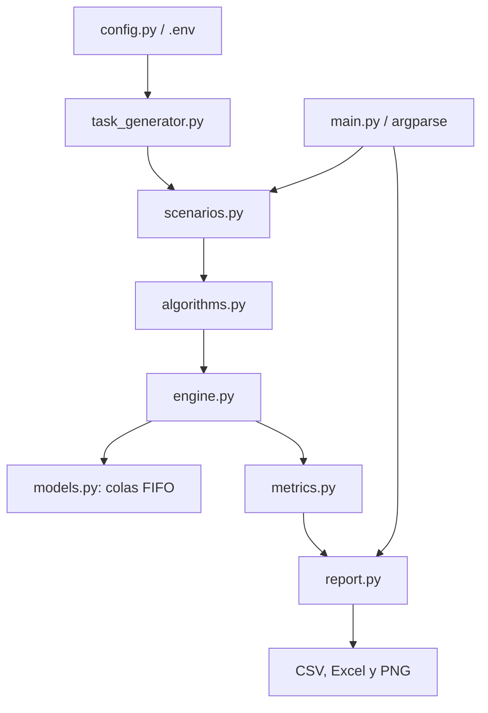

# Arquitectura

## Flujo de datos

`main.py` valida la configuración, genera el mismo conjunto reproducible de
tareas y selecciona uno o todos los escenarios y algoritmos. `scenarios.py`
crea los servidores específicos y delega el procesamiento a `engine.py`.
Este avanza un reloj discreto y registra cada evento. Finalmente,
`metrics.py` calcula las medidas y `report.py` las exporta.

## Flujo normal

En cada instante llegan las tareas correspondientes. El algoritmo elige un
servidor activo y la tarea se agrega a su cola FIFO. Cada servidor procesa el
frente de su cola a una velocidad determinada por su capacidad. El motor
registra asignación, inicio y finalización. Una carga superior al umbral
marca temporalmente al servidor como sobrecargado: sigue procesando, pero no
recibe nuevas tareas hasta recuperarse.

## Flujo ante falla

En el escenario C, al alcanzar el número configurado de asignaciones, se
marca como caído el servidor seleccionado. Las tareas todavía pendientes en
su cola se ponen en espera; la tarea que estaba en proceso conserva el
trabajo que le faltaba. El algoritmo las asigna de nuevo a servidores activos
y el motor registra los eventos de caída y reasignación. Una ejecución sin
servidores capaces de continuar falla explícitamente en lugar de producir un
resultado incompleto.

## Métricas y reportes

Las tareas por servidor se cuentan por finalización (cada tarea aparece una
vez, incluso si se reasignó). La carga por servidor suma las duraciones
originales de las tareas finalizadas en ese servidor. El makespan es el
tiempo transcurrido hasta la última finalización, contando el tick final.
Los reportes reúnen promedios para las repeticiones aleatorias.
