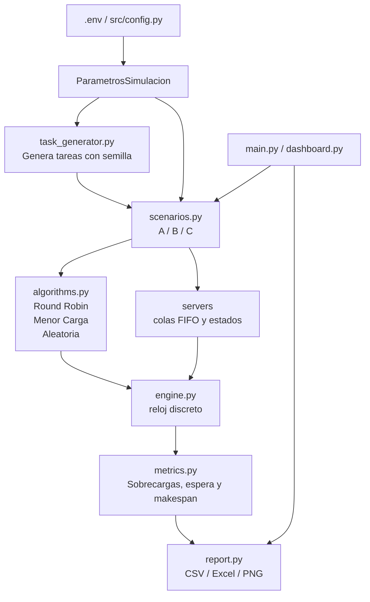

# Arquitectura

## Diagrama general

El flujo comienza en `config.py` y `.env`, que construyen los parámetros de la
simulación. `task_generator.py` crea un conjunto reproducible de tareas con
semillas fijas y tiempos de llegada escalonados. A partir de ahí, `scenarios.py`
construye los servidores según el caso (normal, lenta o caída) y delega la
ejecución al motor de simulación `engine.py`. La estrategia elegida vive en
`algorithms.py` y decide a qué servidor se asigna cada tarea. `metrics.py`
calcula el balance, tiempos de espera y eventos de sobrecarga, y `report.py`
exporta los resultados a CSV, Excel y gráficas.

## Flujo normal

En cada tick del reloj, el motor revisa si llegan nuevas tareas en ese instante.
Cada una se asigna a un servidor disponible mediante la estrategia elegida; si
ningún servidor está libre, la tarea queda en cola de espera. El servidor
procesa su cola FIFO usando su capacidad. Cuando la carga supera el umbral,
se marca como `SOBRECARGADO` y deja de recibir nuevas tareas hasta recuperar su
carga. La recuperación se revisa en cada tick, por lo que vuelve a `ACTIVO`
cuando la carga vuelve a estar por debajo del umbral.

## Flujo ante caída

En el escenario C, cuando se alcanza la tarea configurada, el servidor
seleccionado pasa a `CAIDO`. Las tareas pendientes de su cola conservan el
trabajo restante y se reencolan para reasignación. El motor registra un evento
`CAIDA` y un evento de reasignación para cada tarea restante. Las tareas ya
procesadas no se pierden, y cualquier trabajo pendiente se reutiliza en la
nueva asignación. Si al final no queda ningún servidor activo y siguen existiendo
trabajos pendientes, la simulación falla explícitamente en lugar de devolver un
resultado parcial.

## Métricas y reportes

La métrica de makespan se calcula como el último instante de finalización. La
carga por servidor se obtiene a partir del trabajo pendiente y la capacidad del
servidor. Además, se registran la sobrecarga por nodo, el tiempo medio en cola
y el tiempo máximo de espera cuando no había servidores disponibles. Los reportes
finales agrupan las repeticiones para calcular el promedio y la desviación
estándar de cada métrica.
